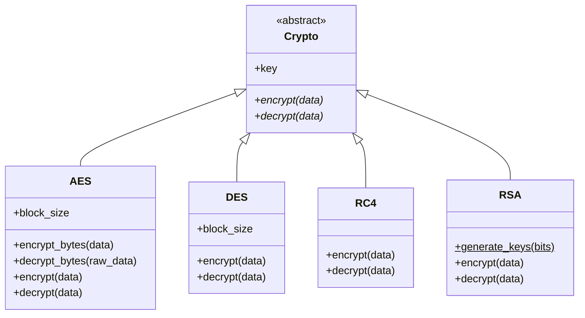
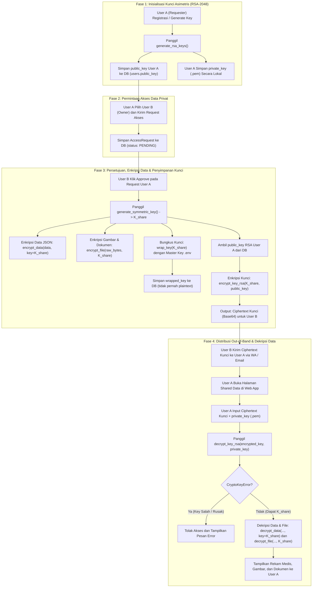

# Dokumentasi Arsitektur & Alur Key Management (`crypto/`)

Dokumen ini mendokumentasikan arsitektur modul `crypto/` (pendekatan OOP, *inheritance*, dan fungsi operasi) serta alur mekanisme **Assignment 2: Key Management** sebagai kelanjutan dari [`documentation.md`](documentation.md).

Pendekatan ini mempertahankan mekanisme enkripsi data utama pada `stroke_records` (`ENCRYPTION_KEY` di `.env`) dan menambahkan dukungan kriptografi asimetris (**RSA**), manajemen kunci simetris (*key wrapping*), serta enkripsi file biner (gambar dan dokumen).

---

## 1. Arsitektur OOP & Struktur Modul `crypto/`

### Struktur Direktori
```text
crypto/
├── __init__.py                  # Ekspor publik kelas cipher, exception, dan fungsi operasi
├── exceptions.py                # CryptoMethodError, CryptoKeyError
├── cipher/
│   ├── crypto.py                # Abstract Base Class Crypto(ABC)
│   ├── aes.py                   # AES(Crypto): AES-CBC 128/192/256 + encrypt_bytes/decrypt_bytes
│   ├── des.py                   # DES(Crypto): DES-CBC 64-bit
│   ├── rc4.py                   # RC4(Crypto): Stream cipher
│   └── rsa.py                   # RSA(Crypto): RSA-2048 dengan PKCS1_OAEP
└── operations/
    ├── __init__.py              # Ekspor fungsi operasi
    ├── get_cipher.py            # Factory get_cipher(method=None, key=None)
    ├── encrypt.py               # encrypt_data(data, key=None, method=None)
    ├── decrypt.py               # decrypt_data(encrypted_data, key=None, method=None)
    ├── data_operations.py       # decrypt_record, decrypt_records
    └── key_management.py        # Generasi kunci, key wrapping, RSA exchange, enkripsi file
```

### Diagram Kelas (OOP & Inheritance)



Semua kelas cipher (`AES`, `DES`, `RC4`, dan `RSA`) mewarisi langsung kelas abstrak `Crypto` di [`crypto/cipher/crypto.py`](crypto/cipher/crypto.py) dan mengimplementasikan kontrak `encrypt(data: str) -> str` serta `decrypt(data: str) -> str`.

---

## 2. Referensi Fungsi Modul `crypto/operations/`

| Modul | Fungsi | Kegunaan |
| :--- | :--- | :--- |
| `get_cipher.py` | `get_cipher(method=None, key=None)` | Mengembalikan instance cipher (`AES`, `DES`, `RC4`, `RSA`). Jika argumen kosong, memakai `ENCRYPTION_METHOD` dan `ENCRYPTION_KEY` dari `.env`. |
| `encrypt.py` | `encrypt_data(data, key=None, method=None)` | Mengubah `dict` menjadi JSON lalu mengenkripsinya menjadi string Base64. |
| `decrypt.py` | `decrypt_data(encrypted_data, key=None, method=None)` | Mendekripsi string Base64 dan mem-parsing kembali menjadi `dict`. |
| `key_management.py` | `generate_rsa_keys(bits=2048)` | Menghasilkan pasangan `(public_key, private_key)` RSA dalam format PEM string. |
| `key_management.py` | `generate_symmetric_key(length=16)` | Menghasilkan kunci simetris acak dalam format hex string (default 16 byte = 32 karakter hex). |
| `key_management.py` | `wrap_key(sym_key, master_key=None)` | Membungkus `sym_key` menggunakan `AES` dengan Master Key (`MASTER_KEY` atau `ENCRYPTION_KEY` dari `.env`) agar aman disimpan di database. |
| `key_management.py` | `unwrap_key(wrapped_key, master_key=None)` | Membuka kembali `wrapped_key` dari database menggunakan Master Key (`MASTER_KEY` atau `ENCRYPTION_KEY` dari `.env`). |
| `key_management.py` | `encrypt_key_rsa(sym_key, public_key)` | Mengenkripsi `sym_key` menggunakan `RSA` public key penerima untuk dikirim lewat jalur luar aplikasi. |
| `key_management.py` | `decrypt_key_rsa(encrypted_key, private_key)` | Mendekripsi `encrypted_key` menggunakan `RSA` private key penerima (`CryptoKeyError` jika kunci tidak cocok). |
| `key_management.py` | `encrypt_file(raw_bytes, key)` | Mengenkripsi bytes file gambar atau dokumen menggunakan `AES.encrypt_bytes()`. |
| `key_management.py` | `decrypt_file(encrypted_bytes, key)` | Mendekripsi bytes file gambar atau dokumen menggunakan `AES.decrypt_bytes()`. |

---

## 3. Integrasi Basis Data & Skema (`models/` & `app.py`)

Integrasi kunci asimetris dan berbagi data privat ditambahkan tanpa mengubah enkripsi data utama pada `stroke_records`.

### A. Pembaruan Tabel `users` (`models/user.py`) & Migrasi Skema (`app.py`)
- Kolom `public_key` (`Text`, `nullable=True`) ditambahkan ke model `User` untuk menyimpan kunci publik RSA-2048 dalam format PEM.
- Fungsi `ensure_schema()` pada [`app.py`](app.py) menjalankan `db.create_all()` sekaligus memeriksa kolom tabel `users` via `PRAGMA table_info(users)` dan mengeksekusi `ALTER TABLE users ADD COLUMN public_key TEXT` jika kolom tersebut belum ada pada basis data SQLite yang sudah terbentuk.

### B. Tabel `private_documents` (`models/share.py`)
Menyimpan metadata berkas privat milik pengguna (gambar atau dokumen), sementara konten binernya disimpan terenkripsi di `instance/uploads/`:

| Kolom | Tipe Data | Keterangan |
| :--- | :--- | :--- |
| `id` | Integer (PK) | Primary Key, auto-increment. |
| `user_id` | Integer (FK) | Merujuk ke `users.id` (`ON DELETE CASCADE`, terindeks). |
| `filename` | String(255) | Nama file asli yang telah disanitasi (`secure_filename`). |
| `mime_type` | String(100) | Tipe MIME berkas (mis. `image/png`, `application/pdf`). |
| `encrypted_filepath` | String(255) | Nama file terenkripsi di `instance/uploads/` (`doc_<user_id>_<uuid>.enc`). |
| `wrapped_key` | Text | Kunci simetris per dokumen yang sudah dibungkus `wrap_key()`. |
| `created_at` | DateTime | Timestamp unggah berkas. |

### C. Tabel `access_requests` (`models/share.py`)
Mencatat siklus permintaan akses antar pengguna beserta *bundle* data terenkripsi ketika permintaan disetujui:

| Kolom | Tipe Data | Keterangan |
| :--- | :--- | :--- |
| `id` | Integer (PK) | Primary Key, auto-increment. |
| `requester_id` | Integer (FK) | Pengguna peminta akses (`users.id`, `ON DELETE CASCADE`). |
| `owner_id` | Integer (FK) | Pemilik data (`users.id`, `ON DELETE CASCADE`). |
| `status` | String(20) | Status permintaan: `PENDING`, `APPROVED`, atau `REVOKED`. |
| `wrapped_sym_key` | Text (Nullable) | Kunci berbagi $K_{\text{share}}$ yang dibungkus dengan `wrap_key()`. Dikosongkan saat `REVOKED`. |
| `shared_payload` | Text (Nullable) | JSON terenkripsi berisi daftar `records` dan metadata `documents` hasil `encrypt_data(..., key=k_share)`. Dikosongkan saat `REVOKED`. |
| `created_at` | DateTime | Waktu permintaan dibuat. |
| `approved_at` | DateTime (Nullable) | Waktu permintaan disetujui oleh pemilik data. |

---

## 4. Integrasi Aplikasi Flask: Blueprint, Endpoint, Session, & UI

Blueprint `share_bp` didefinisikan di [`routes/share.py`](routes/share.py) dengan prefiks `/share`, diekspor melalui [`routes/__init__.py`](routes/__init__.py), didaftarkan di [`app.py`](app.py), dan ditautkan di bilah navigasi (`Berbagi Data` -> `/share`) pada [`templates/base.html`](templates/base.html) bagi pengguna yang telah masuk.

### A. Daftar Endpoint (`routes/share.py`)

| Endpoint | Metode | Template / Output | Mekanisme & Integrasi Kriptografi |
| :--- | :--- | :--- | :--- |
| `/share` | `GET` | [`share.html`](templates/share.html) | Menampilkan daftar pengguna lain (beserta status aktivasi RSA), daftar `incoming` & `outgoing` `AccessRequest`, serta men-generate tautan `wa.me` dan `mailto:` dari `session["outbox_keys"]`. |
| `/share/keys` | `GET` | [`share_keys.html`](templates/share_keys.html) | Menampilkan status *public key*, isi `user.public_key` (PEM), serta tombol unduh satu kali jika `session["pending_pem"]` tersedia. |
| `/share/keys/generate` | `POST` | Redirect ke `/share/keys` | Memanggil `generate_rsa_keys()`, menyimpan `public_key` ke `users.public_key`, dan menyimpan `private_key` sementara di `session["pending_pem"]`. |
| `/share/keys/download` | `GET` | File `<username>_private.pem` | Mengambil sekaligus menghapus (`session.pop("pending_pem")`) kunci privat dari session dan mengirimkannya sebagai unduhan `application/x-pem-file`. |
| `/share/documents` | `GET` | [`share_documents.html`](templates/share_documents.html) | Menampilkan form unggah dan daftar `PrivateDocument` milik pengguna. |
| `/share/documents/upload` | `POST` | Redirect ke `/share/documents` | Memvalidasi ukuran file (1 byte – 5 MB), membuat `doc_key = generate_symmetric_key()`, mengenkripsi bytes via `encrypt_file()`, menulis ke `instance/uploads/doc_<user_id>_<uuid>.enc`, dan menyimpan `wrap_key(doc_key)` ke DB. |
| `/share/documents/<doc_id>` | `GET` | Stream biner (`send_file`) | Memverifikasi kepemilikan, membaca berkas `.enc`, membuka kunci via `unwrap_key(doc.wrapped_key)`, dan mendekripsi dengan `decrypt_file()`. |
| `/share/documents/<doc_id>/delete` | `POST` | Redirect ke `/share/documents` | Menghapus berkas fisik `.enc` di `instance/uploads/` dan baris `PrivateDocument` di DB. |
| `/share/request` | `POST` | Redirect ke `/share` | Mensyaratkan peminta sudah memiliki `user.public_key`; membuat `AccessRequest` berstatus `PENDING` jika belum ada permintaan `PENDING` ke pemilik yang sama. |
| `/share/approve/<req_id>` | `POST` | Redirect ke `/share` | Membuat $K_{\text{share}}$ (`generate_symmetric_key()`), mendekripsi seluruh `StrokeRecord` pemilik (`decrypt_data`), mendekripsi & mengenkripsi ulang setiap `PrivateDocument` pemilik dengan $K_{\text{share}}$ ke `shared_<req.id>_<doc.id>.enc`, mengenkripsi *bundle* JSON dengan `encrypt_data(..., key=k_share)`, membungkus $K_{\text{share}}$ via `wrap_key(k_share)`, lalu mengenkripsi $K_{\text{share}}$ dengan `encrypt_key_rsa(k_share, req.requester.public_key)` dan menyimpannya ke `session["outbox_keys"][str(req.id)]`. |
| `/share/revoke/<req_id>` | `POST` | Redirect ke `/share` | Menghapus berkas `shared_<req.id>_*` di `instance/uploads/`, mengosongkan `wrapped_sym_key` dan `shared_payload`, mengubah status menjadi `REVOKED`, dan menghapus entri dari `session["outbox_keys"]`. |
| `/share/unlock/<req_id>` | `GET`, `POST` | [`share_view.html`](templates/share_view.html) | Menerima ciphertext kunci Base64 dan file/teks *private key* (`.pem`), memanggil `decrypt_key_rsa(enc_key, pem_text)` untuk memperoleh $K_{\text{share}}$, mendekripsi `req.shared_payload`, dan menyimpan $K_{\text{share}}$ sementara di `session["share_keys"][str(req.id)]`. |
| `/share/file/<req_id>/<idx>` | `GET` | Stream biner (`send_file`) | Memeriksa status `APPROVED` dan keberadaan $K_{\text{share}}$ di `session["share_keys"]`, mendekripsi `req.shared_payload` untuk mengambil metadata berkas indeks ke-`idx`, lalu mendekripsi `shared_<req.id>_<doc.id>.enc` dengan `decrypt_file()`. |

### B. State pada Flask `session` & Penyimpanan Berkas
- `session["pending_pem"]`: Menyimpan *private key* RSA dalam memori session setelah generate hingga diunduh satu kali via `/share/keys/download`. *Private key* tidak pernah ditulis ke database.
- `session["outbox_keys"]`: Menyimpan pasangan `{req_id: rsa_encrypted_k_share}` di sisi pemilik data setelah menekan `Approve` agar dapat disalin atau dikirim via WhatsApp/Email.
- `session["share_keys"]`: Menyimpan pasangan `{req_id: k_share}` sementara di sisi penerima setelah berhasil mendekripsi di `/share/unlock/<req_id>`, dipakai oleh endpoint `/share/file/<req_id>/<idx>` untuk merender gambar atau mengunduh dokumen lampiran.
- `instance/uploads/`: Menyimpan berkas biner terenkripsi `doc_<user_id>_<uuid>.enc` (dokumen pribadi pemilik) dan `shared_<req_id>_<doc_id>.enc` (salinan yang dienkripsi ulang dengan $K_{\text{share}}$ untuk permintaan yang disetujui).

---

## 5. Flowchart Mekanisme Berbagi Data & Key Management



---

## 6. Ringkasan Alur & Jaminan Keamanan

1. **Pemisahan Kunci Data Utama dan Kunci Berbagi (*Share Key*):**
   Data `stroke_records` milik sistem tetap dienkripsi dengan `ENCRYPTION_KEY` (`.env`) melalui `encrypt_data()` dan `decrypt_data()`. Saat berbagi data antar pengguna, sistem membuat kunci simetris tersendiri ($K_{\text{share}}$) via `generate_symmetric_key()`.
2. **Penyimpanan Kunci Simetris Secara Aman di Sistem (*Key Wrapping*):**
   $K_{\text{share}}$ dan kunci dokumen privat (`doc_key`) tidak pernah disimpan dalam bentuk *plaintext* di database. Sebelum disimpan, kunci dibungkus menggunakan `wrap_key()` (AES-CBC dengan `MASTER_KEY` atau `ENCRYPTION_KEY` dari `.env`) dan dibuka melalui `unwrap_key()`.
3. **Distribusi Asimetris Out-of-Band:**
   Kunci simetris yang dibagikan ke *requesting user* terlebih dahulu dienkripsi dengan *public key* RSA milik penerima menggunakan `encrypt_key_rsa()` (`PKCS1_OAEP`), lalu disimpan sementara di `session["outbox_keys"]` agar pemilik data dapat mengirimkannya lewat kanal eksternal seperti WhatsApp (`wa.me`) atau Email (`mailto:`).
4. **Private Key Tidak Disimpan di Server:**
   Setelah `generate_rsa_keys()`, hanya `public_key` yang disimpan ke tabel `users`. *Private key* ditaruh sementara di `session["pending_pem"]` dan langsung dihapus saat diunduh via `/share/keys/download` sehingga hanya dimiliki oleh pengguna dalam file `.pem`.
5. **Pencabutan Akses (*Revocation*):**
   Pemilik data dapat mencabut akses kapan saja via `POST /share/revoke/<req_id>`, yang menghapus berkas salinan terenkripsi `shared_<req.id>_*` dari `instance/uploads/`, mengosongkan `wrapped_sym_key` serta `shared_payload` di `access_requests`, dan mengubah status menjadi `REVOKED`.
6. **Dukungan Data Teks, Gambar, dan Dokumen:**
   Data terstruktur (JSON) diproses dengan `encrypt_data(..., key=K_share)` / `decrypt_data(..., key=K_share)`, sedangkan lampiran biner (gambar medis dan dokumen PDF/lainnya, maks. 5 MB per berkas) diproses langsung dengan `encrypt_file()` / `decrypt_file()` berbasis `AES.encrypt_bytes()` dan `AES.decrypt_bytes()`.
